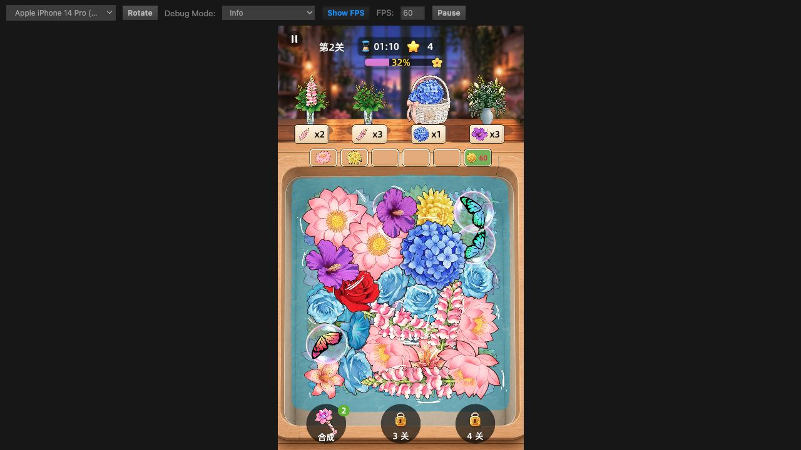

# 原包碰撞、休眠与持续转动复核（2026-11-12）

## 原包证据

直接读取用户提供的 `真的好解压_wx38b4f3dff4fbedf0` 中的 Unity data、WASM 与 IL2CPP 元数据；未启动微信或原版游戏。原始设置及原生 API 名称已保存到 [审计数据](reference/original-contact-rest-audit-2026-11-12.json)。

| 行为 | 原包中的证据 |
| --- | --- |
| 固定物理步长 .02 秒，速度/位置求解 8/3 次 | TimeManager、Physics2DSettings |
| 原生休眠等待 .5 秒，线速度阈值 .01，角速度阈值 2°/秒 | Physics2DSettings；与当前 Cocos 自带 Box2D 默认值一致 |
| 每层只与本层及池壁碰撞，水下不同层允许重叠 | m_LayerCollisionMatrix |
| 原生 CapsuleCollider2D，不存在移植时拆分出的多边形扇形内部边 | 睡莲/荷花预制体碰撞体 |
| 注册时将线性/角阻尼设为 .35/.25，而非预制体初始 2/6 | ApplyRigidbodySetting，WASM 40969；包装器 20374/20375 |
| 水流只向模拟中、醒着的刚体施力；随机旋转是独立 AddTorque | UpdateLayerFlow，40964；IsAwake 20381、AddForce 20388、AddTorque 20389 |
| Up/Middle 使用插值，Bottom 不插值，Down 停止模拟 | 40969 的分支及 20386/20385 |
| SetFlower 的不模拟分支会清速度并 Sleep | 44354 → 20382 |

在已核实的 FlowerWaterFlowController 路径中，没有每帧锁死花朵角度的防抖分支。当前项目已有的接触稳定休眠策略是此前 Cocos 侧优化，不能称为原包算法；本次未继续放宽其阈值。

## 确认的移植错误与修复

1. **非质心施力产生额外扭矩。** 安装的 Creator 3.8.7 JS 后端 `box2d/rigid-body.ts` 中，`applyLinearImpulseToCenter` 实际传给 Box2D 的点是 `GetPosition()`，并非 `GetWorldCenter()`。对偏心碰撞体，它会产生原版线性 AddForce 没有的转动力矩。出生冲量及水流冲量现改为 `getWorldCenter` + `applyLinearImpulse`，通过公共接口传入真正质心，保留原有推力大小。
2. **大角度的三维欧拉分解不适用于只读取 Z 分量。** 上轮将 `Node.angle` 换成 `eulerAngles.z` 只解决了缓存问题，仍漏了通用欧拉分解在 ±90° 外会把旋转拆到 X/Y 的情况。现直接从节点旋转四元数读取完整平面角度，避免画面和碰撞体角度错位；不锁旋转。
3. **胶囊多边形扇形内部接缝卡住重叠花。** 重建的胶囊轮廓超过 Box2D 单多边形 8 顶点限制，Cocos 拆分后的内部边会给出生在内部的另一朵花产生相反方向的接触法线。现用中心矩形和两个圆端的并集表示胶囊外轮廓，不再对胶囊使用扇形拆分。保留原包尺寸、旋转、偏移、质量、摩擦、分层和花池边界。

Cocos 的组合形状与 Unity 的原生胶囊实现并非同一求解器，尤其组合夹具的惯量分布不能据此声称逐位一致。本次保证胶囊几何外边界一致、原指定质量正确，并验证穿插与稳定行为。

## 复现及验证

测试适配器已按实际 Creator 行为修正：便捷中心冲量作用点、四元数和欧拉缓存分别建模；此前适配器把这些行为理想化，漏掉了问题。

- 两项新增回归在修复前失败：偏心碰撞体的线性冲量不应产生扭矩；±179°/±155°/±91° 等旋转应保持图像与物理一致。修复后通过。
- 单独保留已修正施力与角度、换回旧胶囊扇形实现后，原版 `zy_lmg_01` 与 `cdtx_sl_01` 在池角重叠出生，30 秒后中心间距仍只有 **0.923 m**，未能正确分离。排除了仅由角度或施力造成的解释。
- 新胶囊实现使用相同原包三套变体、相同初始位置与角度，在 15/30/60 帧下共 9 组测试均分离，中心间距为 **2.080–2.472 m**；两刚体均进入真实休眠，随后 3 秒位置/角度不再改变。该隔离测试关闭水流/随机扭矩以单独核实碰撞分离，不代表正常关卡停止水流。数据见 [复现记录](reference/contact-pair-reproduction-2026-11-12.json)。
- 442 套原包刚体、480 个原始碰撞体的质量、夹具附着和摩擦检查通过；胶囊在 Cocos 中按需展开为 3 个组件。原有受挤向日葵、移除后唤醒、跨帧率、连续点击等检查通过。
- 全量：215 项，214 通过、0 失败，1 项现有构建产物缺失跳过。TypeScript no-emit 通过。
- 在现有 Creator 7456 服务另开测试预览，保留用户原有预览进度；实际收花进入第二关后续花型，控制台无 error。没有重开编辑器、触碰微信或修改场景/预制体/meta。

正常第二关到 32% 后，3 秒间隔共 8 次采样、跨度约 21 秒，24 个表层物体的最大位置变化为 0.0522 个设计像素；样本中的最高角速度为 0.0296°/秒。20 个标记为接触稳定休眠，其他物体也只剩极小速度；没有把它们说成全部原生休眠。临时诊断只记录到生成预览模块，现已去掉，运行源码未保留日志。数据见 [普通预览采样](validation-images/original-contact-rest-2026-11-12/settled-positions-velocities.json)。

正常预览与隔离复现是不同证据；没有把截图视为任意随机布局下永久无抖动的证明。
